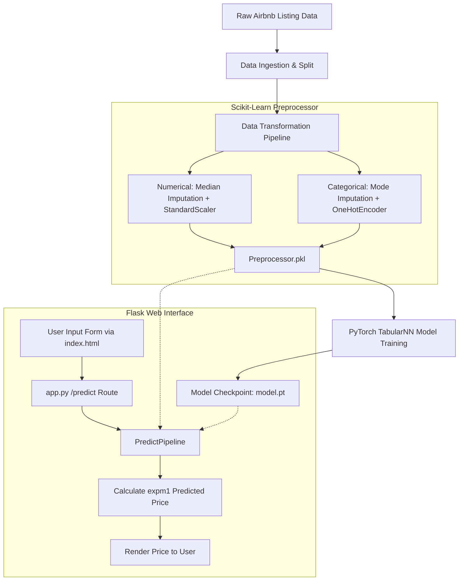

# 🏡 Airbnb Price Prediction

An end-to-end Machine Learning and Deep Learning web application designed to predict optimal nightly rental prices for Airbnb listings. Built with **PyTorch**, **Scikit-Learn**, and **Flask**, this project transforms tabular listing features through a modular pipeline and serves real-time predictions via a sleek, modern user interface.

---

## 📌 Table of Contents

- [Overview](#-overview)
- [Key Features](#-key-features)
- [Architecture & Workflow](#-architecture--workflow)
- [Tech Stack](#-tech-stack)
- [Project Directory Structure](#-project-directory-structure)
- [Installation & Setup](#-installation--setup)
- [Usage & Running the Application](#-usage--running-the-application)
- [Model Architecture & Training](#-model-architecture--training)
- [Features Processed](#-features-processed)
- [License](#-license)

---

## 📖 Overview

Pricing an Airbnb listing accurately is crucial for maximizing occupancy rates and revenue while remaining competitive. This repository provides a complete machine learning solution:
1. **Data Ingestion & Cleaning**: Ingests raw Airbnb listing datasets, cleans unstructured text (e.g., parsing amenities strings, host response percentages), and handles missing values.
2. **Feature Engineering & Transformation**: Standardizes numerical values and one-hot encodes categorical attributes using Scikit-Learn pipelines.
3. **Deep Learning Model**: Utilizes a customized PyTorch feedforward neural network (`TabularNN`) with batch normalization, dropout, and AdamW optimization to predict the logarithmic price (`log_price`).
4. **Flask Web Application**: Serves the trained model via a responsive, glassmorphic web dashboard allowing users to input listing attributes and receive immediate price estimations.

---

## ✨ Key Features

- **Modular MLOps Design**: Structured with distinct components (`components/`, `pipeline/`, `exception/`, `logger.py`, and `utils.py`) for maintainability and scalability.
- **Deep Tabular Neural Network**: Multi-layer PyTorch neural network featuring dynamic input dimension handling, batch normalization, and dropout layers to prevent overfitting.
- **Robust Preprocessing Pipeline**: Automated imputation, one-hot encoding for multi-class categoricals, and standard scaling.
- **Log-Scale Target Stabilization**: Predicts `log_price` and transforms outputs back via `expm1` to mitigate skewness in property price distributions.
- **Interactive Web Interface**: Custom glassmorphism UI with gradient aesthetics, interactive forms, dynamic input controls, and instant prediction feedback.
- **Comprehensive Logging & Error Handling**: Custom exception handlers capturing file-level traceback details, coupled with timestamped logging.

---

## 🏗 Architecture & Workflow



---

## 🛠 Tech Stack

- **Machine Learning & Deep Learning**:
  - [PyTorch](https://pytorch.org/) (Neural network training, GPU acceleration support, Tensor datasets)
  - [Scikit-Learn](https://scikit-learn.org/) (Data pipelines, imputation, encoders, scalers, metrics)
  - [Pandas](https://pandas.pydata.org/) & [NumPy](https://numpy.org/) (Data manipulation and matrix operations)
- **Web Backend & Serving**:
  - [Flask](https://flask.palletsprojects.com/) (RESTful routing and Jinja2 templating)
  - [Dill](https://github.com/uqfoundation/dill) / [Pickle](https://docs.python.org/3/library/pickle.html) (Model & pipeline serialization)
- **Frontend**:
  - HTML5 & Custom CSS (Glassmorphism, animations, responsive grid system)
  - Google Fonts (Inter) and SVG UI icons

---

## 📂 Project Directory Structure

```text
Airbnb-Price-Prediction/
├── Artifacts/                      # Serialized preprocessors, model checkpoints, and data
│   ├── Preprocessor.pkl            # Fitted Scikit-Learn ColumnTransformer pipeline
│   ├── model.pt                    # PyTorch TabularNN model state dictionary
│   ├── raw_data.csv                # Raw listing records
│   ├── train_data.csv              # Split training dataset
│   └── test_data.csv               # Split testing dataset
├── logs/                           # Automated runtime log files
├── src/
│   └── Airbnb/
│       ├── components/             # Core ML stage modules
│       │   ├── Data_transformation.py  # Preprocessing & encoding pipelines
│       │   └── model_trainer.py        # PyTorch TabularNN architecture & training loop
│       ├── pipeline/               # End-to-end inference pipelines
│       │   └── prediction_pipline.py   # PredictPipeline class for inference
│       ├── exception/              # Custom exception wrapper with traceback capture
│       ├── logger.py               # Timestamped logging configuration
│       └── utils.py                # Generic utility functions (save/load pickle, split)
├── static/                         # Frontend assets
│   └── style.css                   # Custom responsive styling and theme tokens
├── templates/                      # Flask UI templates
│   └── index.html                  # Main prediction dashboard & form
├── app.py                          # Flask web application entry point
├── requirements.txt                # Python environment dependencies
├── setup.py                        # Package distribution and packaging configuration
├── test_training_model.py          # Script to execute transformation and model training
├── test_transformer.py             # Script to test and validate preprocessing pipeline
└── README.md                       # Project documentation
```

---

## 🚀 Installation & Setup

### 1. Prerequisites
- Python **3.9+** or higher installed.
- Git installed.

### 2. Clone the Repository
```bash
git clone https://github.com/mugiwara2620/Airbnb-price-prediction.git
cd Airbnb-price-prediction
```

### 3. Create and Activate a Virtual Environment
- **Windows (PowerShell):**
  ```powershell
  python -m venv venv
  .\venv\Scripts\Activate.ps1
  ```
- **macOS / Linux:**
  ```bash
  python3 -m venv venv
  source venv/bin/activate
  ```

### 4. Install Dependencies
```bash
pip install -r requirements.txt
```

---

## 💻 Usage & Running the Application

### 1. Run the Flask Web App
Start the local development server:
```bash
python app.py
```
Open your web browser and navigate to:
```
http://127.0.0.1:5000/
```

### 2. Run Data Transformation & Model Training
To retrain the PyTorch model on the dataset and regenerate artifacts:
```bash
python test_training_model.py
```

### 3. Test the Transformation Pipeline
To inspect the output shapes and intermediate preprocessed arrays:
```bash
python test_transformer.py
```

---

## 🧠 Model Architecture & Training

The core regression model is a PyTorch deep neural network tailored for tabular feature spaces:

```python
TabularNN(
  (price_prediction): Sequential(
    (0): Linear(in_features=input_dim, out_features=256)
    (1): BatchNorm1d(256)
    (2): ReLU()
    (3): Dropout(p=0.1)
    (4): Linear(in_features=256, out_features=128)
    (5): BatchNorm1d(128)
    (6): ReLU()
    (7): Dropout(p=0.05)
    (8): Linear(in_features=128, out_features=64)
    (9): BatchNorm1d(64)
    (10): ReLU()
    (11): Linear(in_features=64, out_features=1)
  )
)
```

- **Objective**: Predict `log_price` using `nn.L1Loss()` (Mean Absolute Error).
- **Optimization**: `torch.optim.AdamW` with learning rate `0.05` and weight decay handling.
- **Evaluation**: Evaluated using $R^2$ score, Root Mean Squared Error (RMSE), and Mean Absolute Error (MAE).

---

## 📊 Features Processed

The model accepts 19 key listing dimensions:

| Feature Name | Type | Description |
| :--- | :--- | :--- |
| `property_type` | Categorical | Type of property (Apartment, House, Loft, Condominium, etc.) |
| `room_type` | Categorical | Entire home/apt, Private room, or Shared room |
| `bed_type` | Categorical | Real Bed, Futon, Pull-out Sofa, Couch, Airbed |
| `cancellation_policy` | Categorical | Flexible, Moderate, Strict, Super Strict |
| `city` | Categorical | Metropolitan city (NYC, LA, SF, Chicago, etc.) |
| `cleaning_fee` | Categorical | Whether cleaning fee is included (`True` / `False`) |
| `host_has_profile_pic` | Categorical | Host identity verification signal (`t` / `f`) |
| `host_identity_verified` | Categorical | Verified status (`t` / `f`) |
| `instant_bookable` | Categorical | Listing availability for direct booking (`t` / `f`) |
| `accommodates` | Numerical | Maximum guest capacity |
| `bathrooms` | Numerical | Number of bathrooms |
| `bedrooms` | Numerical | Number of bedrooms |
| `beds` | Numerical | Number of physical beds |
| `amenities` | Numerical | Total count of amenities provided by the host |
| `host_response_rate` | Numerical | Host communication response percentage (0–100%) |
| `latitude` / `longitude` | Numerical | Precise geographic coordinates |
| `number_of_reviews` | Numerical | Lifetime reviews accumulated |
| `review_scores_rating` | Numerical | Guest satisfaction rating (0–100) |

---

## 📜 License

This project is licensed under the MIT License — feel free to modify, distribute, and use it for your own research or commercial endeavors.